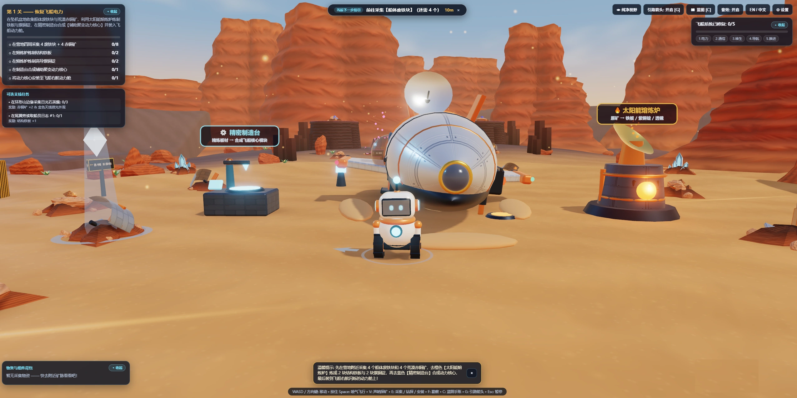

<div align="center">


# 星织号

一款离线运行的 3D 科幻探索生存游戏——驾驶辅助机器人 Milo 穿越荒漠五大生态区、修复星织号七大系统，跃迁重返翡翠母星家园。

[](https://threejs.org)
[](https://nodejs.org)
[](https://esbuild.github.io)

[中文](README.md) · [English](README_en.md)

[开始玩](#开始玩) · [版本沿革](#版本沿革) · [从源码构建](#从源码构建) · [操作](#操作) · [关卡](#关卡) · [提示词与 Skill](#提示词与-skill)

</div>

星织号迫降在荒漠星球卡里斯-4，乘员已经撤离。辅助机器人 Milo 留下来，采集矿物、熔炼零件，把动力、通信、维生、导航、推进、光子热护盾和量子跃迁环装回船体。完成起飞点检后，飞船进入四幕返航，降落在可以自由走动的母星翡翠草甸。

项目构建产出是 `starweaver/dist/` 下的单个 HTML 文件（同时同步到 `docs/index.html`），双击即可在浏览器中离线运行，不请求外部脚本、贴图或字体。界面为简体中文和英文，电脑、平板和手机都可以玩。单文件硬预算是 `1.5 MB`。



## 特性

- **七大荒漠推进关卡**：从坠机盆地一路探索至晶化盐湖与母舰残骸带，随着星织号七大系统逐步修复，船体外观与新区域会同步解锁。
- **昼夜天气联动熔炼**：太阳能熔炼随光照与气候波动（晴昼 `1.5×`、阴天 `0.85×`、星夜与沙暴 `0.55×`），加装储能电池后夜间与沙暴也可稳压至 `1.0×`。
- **工具挂载与自动采矿**：解锁声呐地钻、喷气背包、防风履带、广域声呐与采矿无人机编队，搭配可再生矿脉减少重复跑图。
- **双星球自由探索**：通关并经历四幕超空间返航后，可在母星翡翠河谷自由漫步与飞行，也能随时返回卡里斯-4 并网五大生态区的气象遥测信标。
- **多端自适应与防遮挡 HUD**：桌面键鼠与触屏浮动摇杆双端适配，小屏默认折叠侧边抽屉与次要菜单以保证中心视野，高刷屏自动降频省电。
- **存档平滑继承**：旧版本本地存档可直接读入并衔接当前关卡与母星探索进度。

## 版本沿革

完整记录见 [CHANGELOG.md](CHANGELOG.md)。

| 版本 | 日期 | 内容 |
| --- | --- | --- |
| 1.0.0 | 2026-11-12 | 首次可玩。五关修复、支线、船员日志、声呐钻头、喷气翼、双塔光桥和起飞点检。 |
| 1.0.1 | 2026-11-13 | 程序化 PBR、接触软阴影、后期、卤水倒影、昼夜与沙暴天气，并补齐穿模、相机和存档交接。当时约 `0.950 MB`。 |
| 1.1.0 | 2026-11-14 | 数据驱动的七关框架，东南晶化盐湖与西北母舰残骸带，储能、无人机和四件新挂载，四幕返航与可漫步母星，以及移动端手感和沙暴发热优化。当时约 `1.037 MB`。 |
| 1.2.0 | 2026-11-16 | 多星球懒加载/卸载与公共组件化（`WorldManager`、`hudPrimitives`）、离场停帧与归来补算、全端折叠防遮挡 HUD、母星山川去条纹自然塑形及零侵入沙盒 QA 调试台。当前约 `1.288 MB`。 |

卡里斯-4 只有晴、阴和沙暴，没有雨雪。降水和绿意只出现在母星。

## 开始玩

用浏览器打开仓库里的构建结果：

```text
starweaver/dist/starweaver-<版本>-<YYYYMMDD-HHmmss>.html
```

也可以直接打开已同步的 `docs/index.html`。版本来自 `starweaver/package.json` 的 `version`，时间是构建时的本地时间。文件开头的注释，以及页面 `head` 里的 `version`、`build-time`，与文件名一致。每次构建只保留最新一份。

进度记在浏览器本地。如果站点禁止存储，则只保留在当前这次打开中。

开发时的 `starweaver/index.html` 使用 ES Module，需要本地静态服务，不能直接用 `file://` 打开。

## 从源码构建

在 `starweaver/` 目录执行，需要 Node.js 18 及以上。

`esbuild` 按操作系统安装原生二进制。`node_modules` 从另一台机器拷来之后，先在当前系统重新执行 `npm install`。macOS 对应 `@esbuild/darwin-arm64` 或 `@esbuild/darwin-x64`，Windows x64 对应 `@esbuild/win32-x64`。Windows PowerShell 5.1 不支持 `&&`，命令要分开执行。

### macOS

```bash
npm install
npm run build && npm run verify
npm run audit
```

### Windows

```powershell
npm install
npm run build
npm run verify
npm run audit
```

| 脚本 | 作用 |
| --- | --- |
| `npm run build` | 打包单文件 HTML，并复制到 `docs/index.html` |
| `npm run verify` | 无头检查七关资源、配方缺口、防重复制造、碰撞与交互、返航和母星位面，以及离线与工程红线 |
| `npm run audit` | 检查最新独立 HTML 的 1.5 MB 体积、根标签和离线外链门禁 |

不要手改 `dist/` 或 `docs/index.html`。改动落在 `starweaver/src/` 和 `starweaver/scripts/`，再重新构建。后续开发要守住的离线、存档、移动端和数据表约束写在 [plans/DEV_REDLINES.md](plans/DEV_REDLINES.md)，其中多项已由 `npm run verify` 拦截。 本次全项目走查记录见 [plans/AUDIT_20261114.md](plans/AUDIT_20261114.md)。

## 操作

| 按键 | 作用 |
| --- | --- |
| `WASD` / 方向键 | 移动 |
| 按住 `Space` | 喷气飞行（装备喷气翼后；气罐可把续航翻倍） |
| `V` | 脉冲声呐（装备钻头后；广域声呐把范围扩到 85 m） |
| `E` | 采集、钻探、使用工位、安装、点检、激活机关 |
| `F` | 查看细节 |
| `C` | 随身蓝图 |
| `G` | 脚下引导箭头 |
| `Esc` | 暂停或关闭面板 |
| `U` | 回到营地安全点；母星漫步时回到草甸停机坪 |

触屏会在检测到触摸后显示左摇杆和右侧动作盘。摇杆以按下点为中心，死区是连续曲线。单指转动镜头，双指缩放。触屏文案不带键盘提示。母星纯漫步时只保留摇杆和喷气键。

设置中可以切换中英文、音效、四档画质（极高 / 高 / 中 / 低）、星球昼夜（自动交替 / 白昼 / 星夜）与荒漠天气（动态 / 晴朗 / 沙霾阴天 / 沙尘暴），也可以继续存档、回到营地或重开。第 1 关开始后的前 150 秒保持晴天；标题界面的环绕镜头不消耗这段保护时间。

## 关卡

1. **恢复电力。** 坠机盆地。废铁与赤铜炼成动力核心，装入动力舱。
2. **修复通信。** 东侧低语山脊。石英与银丝矿做成深空通信阵列。这里也可以做储能电池。
3. **钻探与维生。** 南侧干涸峡谷。声呐和螺旋钻头打开地下裂隙，修复维生。履带也在这一关。
4. **飞行与导航。** 西侧中继峡谷。喷气翼飞上孤峰，校准光桥，安装航图核心。营地可启用采矿无人机。
5. **推进。** 北侧玄武岩地热区。飞行和钻探一起用，安装双联等离子主推进器。气罐在这一关。
6. **光子热护盾。** 东南晶化盐湖。穿过盐岩拱门，在会随天气变浑浊的盐盘上采集锂盐和岩盐，激活机背护盾。广域声呐在这一关。
7. **跃迁与返航。** 西北母舰残骸带。从断裂拱肋下方穿行，或飞上悬空甲板，唤醒量子跃迁环。绕船体完成三处起飞点检后登船。

支线和七份船员日志提供额外材料，不阻挡主线。缺料时界面会写明缺什么、缺多少、在哪个区域。引导按整棵配方计算还缺的原矿，并把排队中的子件指到对应工位。

返航分成四幕：点火收起落架并张开护盾，破云掠过环带巨行星，进入跃迁星流，反推降落翡翠草甸。结算后可以选择 **漫步母星草甸家园**。回到卡里斯-4 继续探索时，五大生态区会开放科考气象信标。

## 目录

```text
.
├── pic/
│   ├── interface-zh.webp    中文界面
│   └── interface-en.webp    英文界面
├── prompts/                 本游戏的复刻提示词
├── skills/                  离线 Web 3D 游戏的 Agent Skill
├── plans/                   研发红线与规划记录
├── docs/index.html          与最新构建同步的页面副本
├── starweaver/
│   ├── assets/logo.png      标志
│   ├── index.html           开发入口
│   ├── package.json
│   ├── scripts/             打包与数据校验
│   ├── src/
│   │   ├── data/            关卡、配方、装备、中英文案
│   │   ├── state/           进度与存档
│   │   ├── graphics/        环境、后期、天气、程序化模型
│   │   ├── scene/           世界、星织号、相机
│   │   ├── entities/        Milo
│   │   ├── systems/         交互、引导、昼夜天气
│   │   ├── ui/              界面与触控
│   │   └── audio/           程序化音效
│   └── dist/                starweaver-<版本>-<时间>.html
├── CHANGELOG.md
├── README.md
└── README_en.md
```

画面使用程序化网格、GPU 烘焙的 PBR 贴图和 PMREM 环境反射。桌面高画质使用接触软阴影；后期包含环境光遮蔽、体积光、多层辉光和胶片调色。辉光加在炉火、晶体、护盾和能量桥上。关卡、区域、工位、装备、机关、卤水池和地形修饰都登记在 `starweaver/src/data/gameData.js`，不散落在按钮回调里。

## 提示词与 Skill

`prompts/` 和 `skills/` 用途不同。

`prompts/web3d-spacecraft-game-master-prompt.md` 是本游戏的完整复刻提示词。打开文件，复制其中的代码块，贴给任意对话模型或编程助手，即可按同一规格从零做出一款同等级的离线三维游戏。前半是玩法规格，后半是本项目打磨后的工程与体验要求。

`skills/game-web3d-standalone-builder/` 给支持 Agent Skills 的助手使用，例如 Codex、Claude、Cursor。它本身不绑定这一款的剧情，描述的是「模块化源码 + 单文件离线 HTML」的通用做法。助手会根据 `SKILL.md` 相关技能，在相关任务里自动加载构建类似的游戏。

| 文件 | 用途 |
| --- | --- |
| `SKILL.md` | 助手的操作步骤：数据、画面、引导、界面、打包与验收 |
| `README.md` | 给人看的设计说明和构建记录 |
| `SCENARIOS.md` | 六条玩家视角的验收场景 |
| `scripts/audit-standalone-html.mjs` | 检查单文件 HTML 的体积和外链 |

离线检查在仓库根目录单独执行：

```bash
node skills/game-web3d-standalone-builder/scripts/audit-standalone-html.mjs
```

## 致谢

- [Three.js](https://threejs.org/)
- [esbuild](https://esbuild.github.io/)
