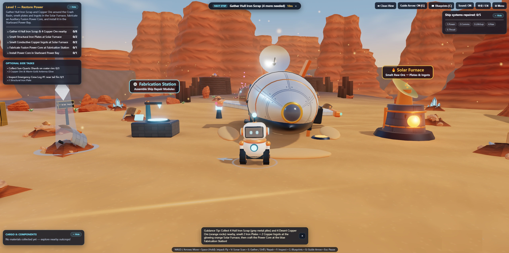

<div align="center">


# Starweaver

An offline 3D game of exploration, gathering, and spacecraft repair. The current version is **1.2.0**. The build is a single HTML file of about 1.29 MB.

[](https://threejs.org)
[](https://nodejs.org)
[](https://esbuild.github.io)

[中文](README.md) · [English](README_en.md)

[Play](#play) · [Versions](#versions) · [Build from source](#build-from-source) · [Controls](#controls) · [Levels](#levels) · [Prompts and the skill](#prompts-and-the-skill)

</div>

The Starweaver crash-lands on the desert planet Kharis-4. The crew has already evacuated. The helper robot Milo stays behind, gathers minerals, smelts parts, and fits power, communications, life support, navigation, propulsion, a photonic heat shield, and a quantum jump ring back onto the hull. After the pre-flight checks, a four-act return flight lands on the homeworld meadow, which can be walked.

The build output is one HTML file. The current deliverable, `starweaver/dist/starweaver-1.2.0-20261116-202515.html`, is `1,350,448` bytes (about `1.288 MB`). Double-click it to run in a browser, with no requests for external scripts, textures, or fonts. The same file is copied to `docs/index.html`. The interface supports Simplified Chinese and English, and runs on desktop, tablet, and phone. The hard size budget for the single file is `1.5 MB`.



## Features

- Seven continuous levels. Regions, recipes, stations, equipment, and the ship's appearance advance with the repairs. The rules live in data tables.
- Smelting, fabrication, and batch crafting. Solar smelting follows the day-night cycle and the weather: `1.5×` in clear daylight, `0.85×` under overcast skies, and `0.55×` at night or in a sandstorm. The storage battery holds night and sandstorm smelting at `1.0×`.
- Sonar drilling, jet flight, and optional gear: treads, a thruster tank, a wide sonar array, and mining drones. Main-path veins have fixed yields and regrow.
- Clearing the game plays a skippable 12.4-second, four-act return. Milo can then drive and fly across the homeworld meadow. Back on Kharis-4, five climate beacons can be brought online.
- On medium and small screens the sidebars start collapsed. Touch uses a floating stick. 60 Hz and 90 Hz screens run every frame; faster panels drop to one frame in two.
- A 1.0.x / 1.1.x local save loads into 1.2.0 and continues into the newly unlocked levels and Homeworld state.

## Versions

The full record is in [CHANGELOG.md](CHANGELOG.md).

| Version | Date | Contents |
| --- | --- | --- |
| 1.0.0 | 2026-11-12 | First playable build. Five repair levels, side tasks, crew logs, the sonar drill, jet wings, the twin-pylon light bridge, and pre-flight checks. |
| 1.0.1 | 2026-11-13 | Procedural PBR, contact-hardening shadows, post-processing, brine reflections, the day-night cycle, and sandstorms, plus clipping, camera, and save handoff fixes. About `0.950 MB`. |
| 1.1.0 | 2026-11-14 | A data-driven seven-level framework, the southeast salt flats and northwest mothership wreckage, the battery, drones, and four new fittings, the four-act return and walkable homeworld, and mobile feel and sandstorm heat fixes. About `1.037 MB`. |
| 1.2.0 | 2026-11-16 | Multi-world lazy loading/disposal and shared primitives (`WorldManager`, `hudPrimitives`), away-time freeze with return catch-up, viewport-first collapsible HUD, natural de-striped homeworld mountains, and a non-intrusive sandbox QA console. About `1.288 MB`. |

Kharis-4 has clear, overcast, and sandstorm weather. It does not rain or snow. Water and greenery belong to the homeworld.

## Play

Open the build already in the repository:

```text
starweaver/dist/starweaver-<version>-<YYYYMMDD-HHmmss>.html
```

`docs/index.html` is the same file, kept in sync. The version comes from `version` in `starweaver/package.json`. The time is the local time of the build. The comment at the top of the file, and the `version` and `build-time` tags in `head`, match the file name. Each build keeps only the latest file.

Progress is stored locally in the browser. If the site blocks storage, it lasts only for the current session.

During development, `starweaver/index.html` uses ES modules. It needs a local static server and cannot be opened directly with `file://`.

## Build from source

Run the commands in the `starweaver/` directory. Node.js 18 or above is required.

esbuild installs a native binary for the operating system. If `node_modules` was copied from another machine, run `npm install` again on the current system. macOS uses `@esbuild/darwin-arm64` or `@esbuild/darwin-x64`. Windows x64 uses `@esbuild/win32-x64`. Windows PowerShell 5.1 does not support `&&`, so run the commands separately.

### macOS

```bash
npm install
npm run build && npm run verify
npm run audit
```

### Windows

```powershell
npm install
npm run build
npm run verify
npm run audit
```

| Script | What it does |
| --- | --- |
| `npm run build` | Pack the single-file HTML and copy it to `docs/index.html` |
| `npm run verify` | Headless check of all seven levels, recipe gaps, duplicate-craft locks, colliders and interactables, the return flight and homeworld plane, plus offline and engineering gates |
| `npm run audit` | Check the latest standalone HTML size, root tag, and offline-link gate |

Do not edit `dist/` or `docs/index.html` by hand. Change `starweaver/src/` and `starweaver/scripts/`, then build again. The offline, save, mobile, and data-table constraints for later work are in [plans/DEV_REDLINES.md](plans/DEV_REDLINES.md). `npm run verify` already blocks several of them. The full project audit is recorded in [plans/AUDIT_20261114.md](plans/AUDIT_20261114.md).

## Controls

| Key | Action |
| --- | --- |
| `WASD` / arrows | Move |
| Hold `Space` | Jet flight, after the wings are equipped; the tank doubles the duration |
| `V` | Pulse sonar, after the drill is equipped; the wide array extends it to 85 m |
| `E` | Gather, drill, use a station, install, run a check, or activate a mechanism |
| `F` | Inspect details |
| `C` | Portable blueprints |
| `G` | Guide arrow at your feet |
| `Esc` | Pause or close a panel |
| `U` | Return to the camp safe point; on the homeworld, return to the meadow pad |

After a touch is detected, a left stick and a right action pad appear. The stick is centered on the touch, and the dead zone is a continuous curve. One finger turns the camera. Two fingers zoom. Touch copy does not include keyboard hints. While only roaming the homeworld, the pad keeps the stick and the jet button.

Settings can switch between Chinese and English, sound, four graphics levels (Ultra, High, Medium, Low), the planetary day-night cycle (Auto, Daylight, Starry Night), and Kharis-4 desert weather (Dynamic, Clear, Overcast, Sandstorm), and can continue a save, return to camp, or start over. The first 150 seconds after level 1 starts stay clear. The title camera does not spend that time.

## Levels

1. **Restore power.** Crash Basin. Scrap and copper are smelted into a power core and installed in the power bay.
2. **Repair communications.** Whispering Ridge, to the east. Quartz and silver ore become the deep-space array. The storage battery is also made here.
3. **Drilling and life support.** The dry canyon, to the south. Sonar and the spiral drill open underground fissures, and life support is repaired. The treads are made in this level.
4. **Flight and navigation.** The relay gorge, to the west. The wings fly up to the spire, the light bridge is aligned, and the navigation core is installed. The camp can launch mining drones.
5. **Propulsion.** The basalt vents, to the north. Flight and drilling are used together to install the twin plasma drive. The thruster tank is made here.
6. **Photonic heat shield.** The crystalline salt flats, to the southeast. Cross the saltstone arch, gather lithium and halite on a pan whose reflection dulls with the weather, and activate the dorsal shield. The wide sonar is made in this level.
7. **Jump home.** The mothership wreckage, to the northwest. Pass under the broken ribs or fly onto the hanging deck, and wake the quantum jump ring. After three hull checks, board the ship.

Side tasks and seven crew logs provide extra materials and do not block the main path. When materials are missing, the UI states what is missing, how many, and in which region. Guidance totals the raw ore still missing across the whole recipe tree, and points a queued part at the station that actually makes it.

The return has four acts: ignition, gear retraction, and the shield; a climb past the ringed giant; the jump stream; and a landing on the emerald meadow. After the summary, choose **Walk the homeworld meadow**. Returning to Kharis-4 opens climate beacons in the five biomes.

## Directory

```text
.
├── pic/
│   ├── interface-zh.webp    Chinese interface
│   └── interface-en.webp    English interface
├── prompts/                 Reproduction prompt for this game
├── skills/                  Agent skill for offline Web 3D games
├── plans/                   Engineering constraints and planning notes
├── docs/index.html          Page copy kept in sync with the latest build
├── starweaver/
│   ├── assets/logo.png      Logo
│   ├── index.html           Development entry
│   ├── package.json
│   ├── scripts/             Packaging and data checks
│   ├── src/
│   │   ├── data/            Levels, recipes, equipment, Chinese and English copy
│   │   ├── state/           Progress and saves
│   │   ├── graphics/        Environment, post-processing, weather, procedural models
│   │   ├── scene/           World, Starweaver, camera
│   │   ├── entities/        Milo
│   │   ├── systems/         Interaction, guidance, day-night and weather
│   │   ├── ui/              Interface and touch
│   │   └── audio/           Procedural sound
│   └── dist/                starweaver-<version>-<time>.html
├── CHANGELOG.md
├── README.md
└── README_en.md
```

The scene uses procedural meshes, GPU-baked PBR textures, and PMREM environment reflections. Desktop high quality uses contact-hardening shadows. Post-processing includes ambient occlusion, volumetric light, multi-layer bloom, and filmic grading. Bloom is applied to the furnace, crystals, the shield, and the energy bridge. Levels, regions, stations, equipment, mechanisms, brine pools, and terrain modifiers are registered in `starweaver/src/data/gameData.js`, not scattered across button callbacks.

## Prompts and the skill

`prompts/` and `skills/` are for different jobs.

`prompts/web3d-spacecraft-game-master-prompt.md` is the full reproduction prompt for this game. Open the file, copy the code block, and paste it to any chat model or coding assistant to build an offline 3D game of the same grade from scratch. The first half is the gameplay specification. The second half is the engineering and experience bar reached on this project.

`skills/game-web3d-standalone-builder/` is for assistants that support Agent Skills, such as Codex, Claude, and Cursor. It is not tied to this game's story. It describes the general method: modular source plus one offline HTML file. On a related task, the assistant loads the skill in `SKILL.md` and builds a similar game.

| File | Use |
| --- | --- |
| `SKILL.md` | Steps for the assistant: data, picture, guidance, interface, packaging, and acceptance |
| `README.md` | Design notes and build records for people |
| `SCENARIOS.md` | Six acceptance scenarios from the player's point of view |
| `scripts/audit-standalone-html.mjs` | Checks the size and external links of the single-file HTML |

The offline check is run on its own from the repository root:

```bash
node skills/game-web3d-standalone-builder/scripts/audit-standalone-html.mjs
```

## Acknowledgements

- [Three.js](https://threejs.org/)
- [esbuild](https://esbuild.github.io/)
